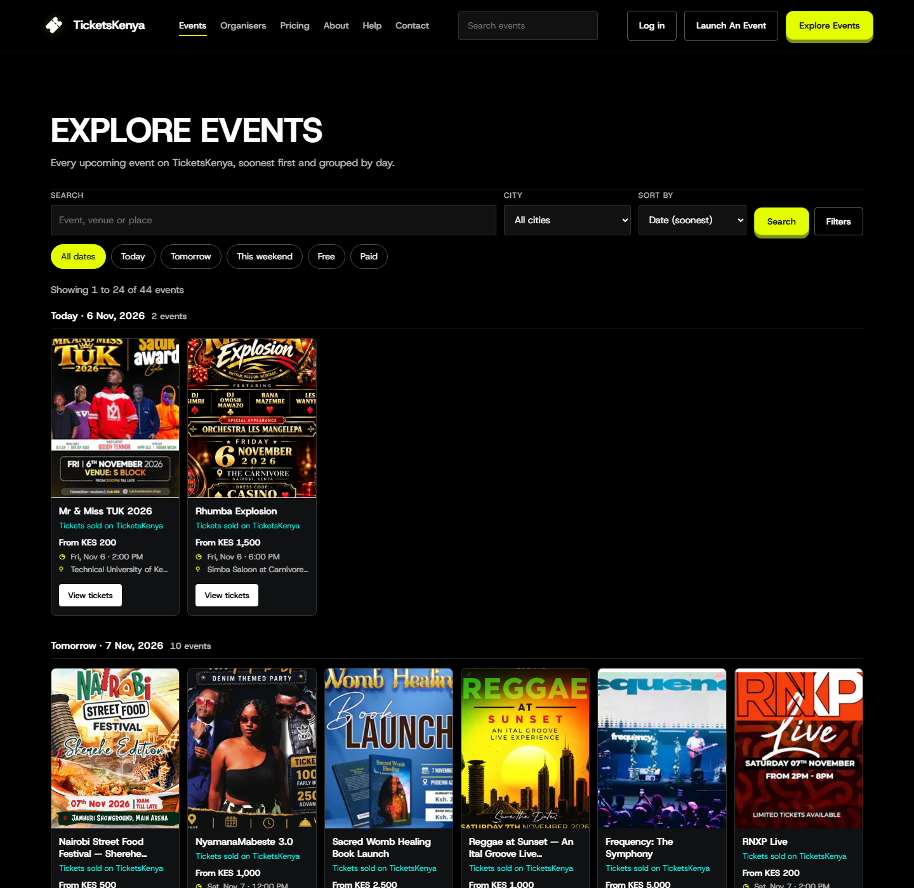
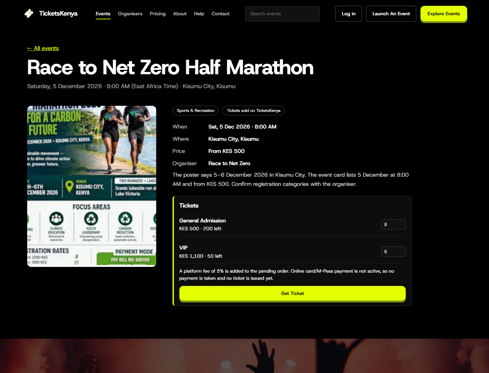
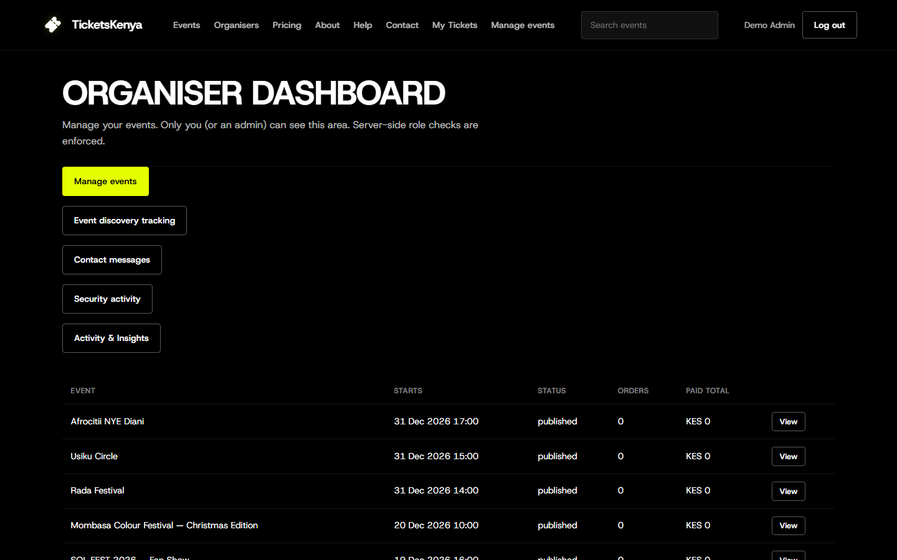
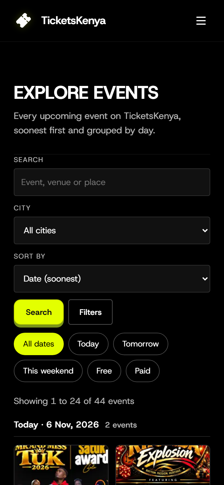
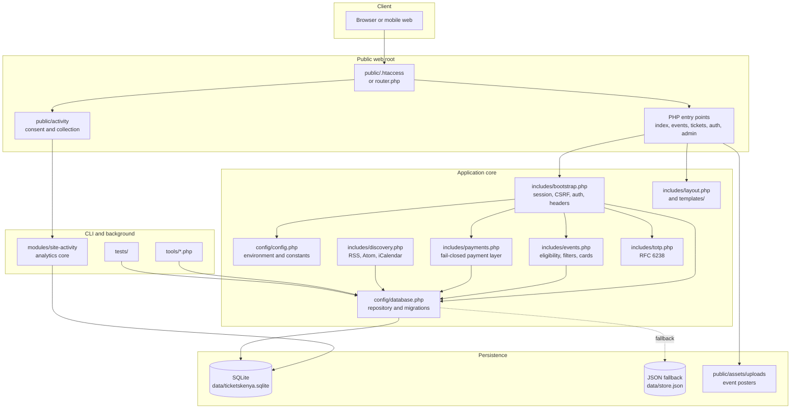
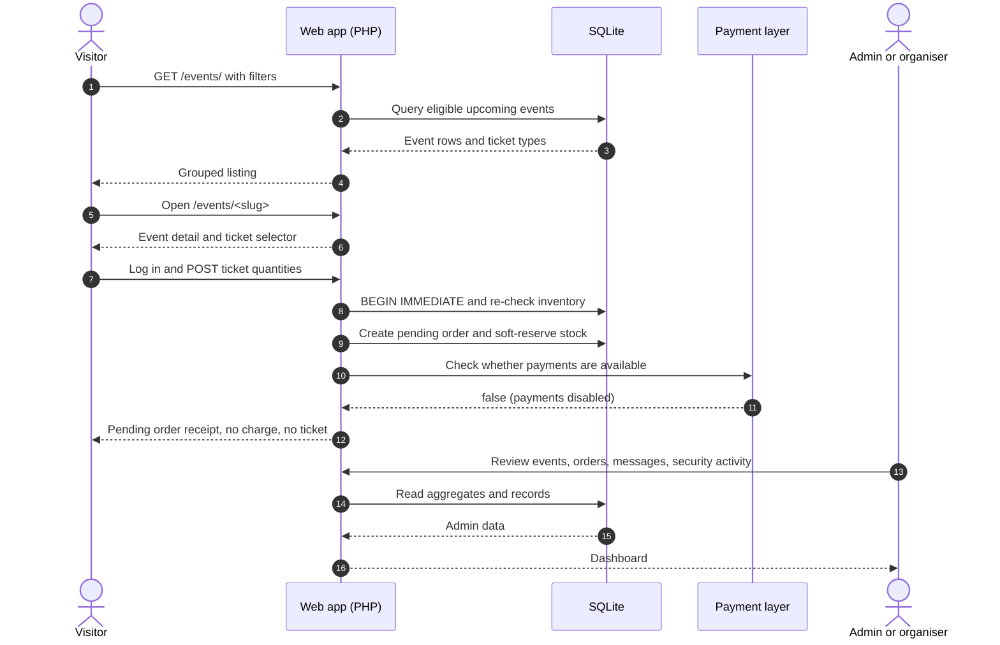
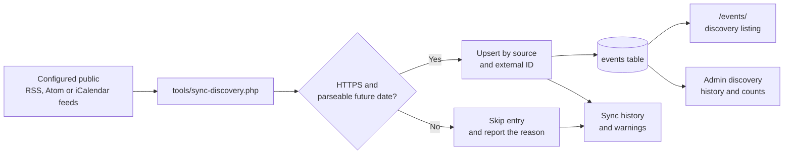
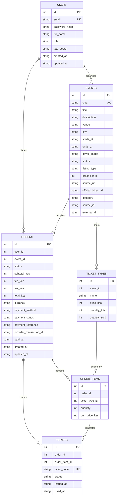

<p align="center">
  
</p>

<h1 align="center">TicketsKenya</h1>

<p align="center">
  <strong>A self-hosted event discovery and ticketing platform for Kenya.</strong><br>
  Built with plain PHP 8 and SQLite. No framework, no build step, no paid dependencies.
</p>

<p align="center">
  
  
  
  
  
  
  
</p>

> **Development build.** The public marketplace, accounts, organiser and admin tools, discovery pipeline, and a fail-closed checkout foundation are implemented. Online payments are intentionally disabled, so checkout creates a pending order and never charges a card or issues a ticket. Email delivery is not configured. This repository is not production-ready.

<p align="center">
  <a href="#overview">Overview</a> ·
  <a href="#screenshots">Screenshots</a> ·
  <a href="#features">Features</a> ·
  <a href="#architecture">Architecture</a> ·
  <a href="#application-workflow">Workflow</a> ·
  <a href="#database-design">Database</a> ·
  <a href="#installation">Installation</a> ·
  <a href="#configuration">Configuration</a> ·
  <a href="#security">Security</a> ·
  <a href="#deployment">Deployment</a> ·
  <a href="#roadmap">Roadmap</a>
</p>

---

## Overview

TicketsKenya is an event marketplace and ticketing application designed around the Kenyan events scene. It brings two different kinds of listings into one calendar: **TicketsKenya-owned inventory** that can enter the internal checkout flow, and **discovery listings** that help people find events without pretending the platform sells those tickets.

The application is intentionally lightweight. There is no Laravel, no Symfony, no Composer autoloader, no Node build, and no external runtime service. Pages are server-rendered PHP; the data layer prefers SQLite through PDO and falls back to a JSON store when `pdo_sqlite` is unavailable. The document root is `public/`; configuration, code, data, tests, and tools live outside it.

The current build is aimed at local development, review, and the next implementation phase. It is not a finished commercial product.

### What is working

| Area | Current state |
|---|---|
| Public event marketplace | Published upcoming events, date grouping, search, city/category/date/price filters, pagination |
| Discovery listings | Imported and feed-synced listings clearly separated from sellable inventory |
| Accounts and roles | Customer registration, customer / organiser / admin roles, secure sessions |
| Ticket checkout foundation | Pending orders, server-side pricing, soft inventory reservation, order receipt |
| Payments | Deliberately disabled and fail-closed; no provider is integrated |
| Administration | Event management, poster uploads, contact inbox, security activity, discovery history |
| Privacy analytics | First-party, consent-gated activity module with retention and export |
| Operations | CLI import, feed sync, readiness check, inventory reclassification, tests |

---

## Screenshots

Screenshots come from the local development build. They contain demo data and locally hosted event posters; no production user data is shown.

### Public marketplace


*Homepage hero and upcoming-event carousel.*



*Event marketplace with search, city, date, category and price filters.*

### Event detail and ticket selection



*Event page with listing metadata, ticket types, and the inactive payment notice.*

### Organiser and administration



*Organiser dashboard. Administrators can also open discovery tracking, messages, security activity, and analytics.*

### Mobile layout

<p align="center">
  
  &nbsp;&nbsp;&nbsp;
  
</p>

*Responsive homepage and event listing at 390 px.*

---

## Features

### Event discovery and marketplace

- Public listings only include events whose status is `published` or `sold_out`, whose start date parses, and whose end time has not passed.
- Events are grouped by day, paginated at 24 per page, and sorted by date or title.
- Filters cover free-text search, city, category, today / tomorrow / this weekend, date range, and free / paid.
- A free or paid label is shown only when a TicketsKenya ticket type confirms the price. Unknown prices display as “Price not confirmed”; the application does not invent them.
- Cancelled, draft, unpublished, archived, past, and invalid-date records stay out of public listings.
- Event pages include canonical URLs, Open Graph metadata, `schema.org` Event structured data, breadcrumbs, and clean `/events/<slug>` routes.
- `robots.txt` and `sitemap.xml` are generated from the configured application URL.

### Discovery listings versus owned inventory

- Every event has a `listing_type` of `owned` or `discovery`.
- Discovery listings are informational. Their detail pages do not offer checkout and do not send visitors to an external purchase page.
- Only `owned` events with a published status can reach the internal ticket selector.
- Discovery records keep their source URL and verification date so provenance is visible to administrators.

### Ticket and order foundation

- Checkout requires a logged-in customer.
- Prices are read from the server-side ticket types; the browser cannot supply a price.
- Orders are created with a `pending` status and a `pending`/`unpaid` payment state.
- Inventory is soft-reserved when the order is created. The read/check/reserve sequence uses a file lock and, on SQLite, an immediate write transaction.
- The platform fee defaults to 5% and is configurable. Tax is stored as `0` because no tax rules are configured.
- The order receipt shows the real server-side totals, payment status, ticket data, and the email-delivery limitation.
- Ticket issuance exists in `includes/payments.php` as a locked, idempotent function intended for a future verified provider callback. It cannot be triggered into issuing tickets by the current browser endpoints.
- **No payment provider is integrated.** All payment start, callback, webhook, and status endpoints fail closed. Setting `TK_PAYMENTS_ENABLED=true` does not create a provider integration.

### Accounts, roles, and 2FA

- Public registration creates a `customer` account.
- `organiser` accounts can manage their own events; `admin` accounts can manage all events and access operational pages.
- Authorization is enforced server-side with `tk_require_login()` and `tk_require_role()`; hiding a link is never the access control.
- Passwords use `PASSWORD_ARGON2ID` with a fallback to the platform default.
- Login attempts are rate-limited per email and per IP address.
- Sessions use strict mode, HttpOnly cookies, `SameSite=Lax`, and the Secure flag when HTTPS is detected. Session IDs regenerate on login, and the pre-login CSRF token is discarded.
- Optional RFC 6238 TOTP two-factor authentication is available for any account with a stored secret. Enrolment requires a valid current code before the secret is saved.
- Password reset by email is not implemented. A CLI tool is provided for an operator to reset a password.

### Administration

- Event creation and editing, including poster upload and status management.
- Poster uploads accept JPEG, PNG, or WebP, are capped at 3 MB and 6000 px, are validated with `getimagesize()`, and are stored under a server-generated random filename.
- Organisers see only their own events; administrators see all events.
- Contact messages are stored in the database and can be marked handled or reopened.
- Security activity shows recent authentication and suspicious-request signals with minimized network prefixes and a 30-day retention window.
- Event discovery tracking shows configured sources, sync history, counts, and recorded changes.
- The optional Activity & Insights dashboard reports consenting first-party analytics.

### Discovery pipeline

- `tools/sync-discovery.php` reads explicitly configured public RSS, Atom, or iCalendar feeds from `tools/discovery-sources.json`.
- Feed URLs must be HTTPS. Entries without a parseable future date are skipped rather than guessed.
- Listings are upserted by source and stable external ID, with a bounded history written to `data/discovery-sync-log.json`.
- The synchronizer never deletes a listing merely because it disappears from a feed, and never marks an event cancelled unless the source says so.
- A bundled sample iCalendar source is disabled by default because the provider's terms prohibit republication without permission. Enable a source only when its terms allow the intended reuse.
- `tools/import-discovery.php` imports the local seed file idempotently. Run it repeatedly without creating duplicates.
- Both tools are CLI-only and protected against accidental web execution.

### Privacy-first analytics

- The `modules/site-activity` module is first-party: no third-party analytics script, no external service.
- Collection is consent-gated. Visitors can accept or reject optional analytics and change their choice later.
- Event and session records are redacted, rate-limited, and retention-pruned.
- The module creates only tables prefixed with `activity_` and switches itself off when SQLite is unavailable.
- Analytics exports guard against CSV formula injection.

### Operations and testing

- `tools/production-check.php` is a read-only readiness report with a strict mode.
- `tools/reclassify-inventory.php` changes only `listing_type`, is a dry run by default, and never deletes events, ticket types, or orders.
- `tools/setup-2fa.php` enrols or disables TOTP.
- Portable tests cover PHP syntax, integrity checks, payment fail-closed behavior, TOTP vectors, discovery parsing, and seed-import idempotency.
- HTTP regression and CRUD suites exist for a disposable local database.

---

## Architecture

TicketsKenya uses a small, explicit request path. Apache or nginx exposes only `public/`; everything else is outside the web root. The built-in PHP server uses `public/router.php` for local development.



### Request path

1. The web server maps the request to `public/`.
2. `.htaccess` or `router.php` serves clean event URLs and blocks dotfiles and data-like files.
3. The page includes `includes/bootstrap.php`, which loads configuration, starts a hardened session, applies security headers, and runs additive migrations.
4. Page logic reads or writes through the repository helpers in `config/database.php`.
5. Templates render escaped output. No user-supplied HTML is trusted.

### Trust boundaries

| Boundary | Rule |
|---|---|
| Web root | Only `public/` is exposed. `config/`, `data/`, `includes/`, `modules/`, `templates/`, `tests/`, and `tools/` are outside it. |
| Project root | A root `.htaccess` denies all requests as a backstop against a misconfigured virtual host. |
| Uploads | `public/assets/uploads/.htaccess` disables PHP execution and denies script extensions. |
| Payments | All payment endpoints fail closed; no browser request can mark an order paid. |
| Secrets | `.env` lives in the project root and is excluded from version control. |
| CLI tools | Destructive or administrative tools refuse to run outside `PHP_SAPI === 'cli'`. |

---

## Application workflow

### Buying a ticket for an owned event



The important invariant is that an unverified browser request cannot move an order to `paid` or create tickets. When a provider is added later, it must verify the transaction server-side and then call the locked issuer.

### Discovery ingestion



Discovery ingestion is deliberately conservative. A failed feed does not mean there are no events, and a missing entry does not delete an existing listing.

---

## Database design

The data layer prefers SQLite through PDO. When `pdo_sqlite` is unavailable, it falls back to `data/store.json`. The SQLite path is the supported production path; the JSON store is a development fallback.



### Core tables

| Table | Purpose |
|---|---|
| `users` | Accounts and roles. `role` is `customer`, `organiser`, or `admin`. Optional `totp_secret` enables 2FA. |
| `events` | Event records, including provenance fields for discovery listings and stock-independent metadata. |
| `ticket_types` | Tickets owned and priced by TicketsKenya. `quantity_total` and `quantity_sold` drive availability. |
| `orders` | One order per checkout attempt. Stores subtotal, platform fee, tax, total, payment state, and provider references. |
| `order_items` | Line items with quantity and the unit price captured at order time. |
| `tickets` | Issued tickets with a unique non-sequential code and lifecycle status. |
| `contact_messages` | Public contact-form submissions with an IP prefix and a handled flag. |
| `login_attempts` | Short-lived rate-limit data. Pruned after 24 hours. |
| `security_events` | Minimized security signals. Pruned after 30 days. |

### Design decisions

- **Money is stored as integer KES.** No floating-point arithmetic is used for prices or totals.
- **Migrations are additive and automatic.** `tk_migrate_sqlite()` runs on bootstrap, uses `CREATE TABLE IF NOT EXISTS` and guarded `ALTER TABLE ... ADD COLUMN`, and has no destructive step.
- **Inventory is soft-reserved.** A pending order increments `quantity_sold`; the design assumes an operator or future workflow releases abandoned reservations.
- **Order ownership is checked on read.** Customer order and ticket pages filter by the authenticated user id.
- **Referential integrity is handled in application code.** The schema defines primary keys, unique indexes, and lookup indexes; it does not declare database-level foreign keys.
- **Activity tables are separate.** The analytics module creates `activity_settings`, `activity_sessions`, `activity_events`, `activity_consent`, `activity_audit_logs`, `activity_audiences`, `activity_order_links`, `activity_rate`, and `activity_errors`. It never alters non-`activity_` tables.

---

## Installation

### Requirements

| Requirement | Details |
|---|---|
| Operating system | Windows 10 or 11 for the XAMPP instructions below; Linux/macOS work with the equivalent PHP binary |
| PHP | 8.1 or newer. Tested on PHP 8.2.12 (XAMPP build) |
| PHP extensions | `pdo_sqlite`, `fileinfo`, `openssl`, `session`, `json`; `mbstring` is optional |
| Web server | Apache with `mod_rewrite`, nginx with PHP-FPM, or the PHP built-in server for local development |
| Storage | Writable `data/` and `public/assets/uploads/` directories |
| Dependencies | None. No Composer, npm, or build step |

### 1. Clone the repository

```bat
cd C:\xampp\htdocs
git clone https://github.com/samsonnyaga474/TicketsKenya.git
cd TicketsKenya
```

Confirm PHP and SQLite are available:

```bat
C:\xampp\php\php.exe -v
C:\xampp\php\php.exe -m | findstr pdo_sqlite
```

If `pdo_sqlite` is missing, enable it in XAMPP's `php.ini` and restart the service. Without it, the application falls back to the JSON store, which is not recommended beyond local development.

### 2. Create a private environment file

Create a file named exactly `.env` in the project root, next to `README.md`. Do not create it inside `public/`, and do not commit it.

```dotenv
TK_ENV=development
TK_APP_URL=http://localhost:8080
TK_DEMO_MODE=true
TK_TRUST_PROXY=false
TK_SUPPORT_EMAIL=you@example.com
TK_PAYMENTS_ENABLED=false
```

`.env` is excluded by `.gitignore`. The repository deliberately does not publish an environment template; use the configuration table below.

### 3. Run the local server

```bat
cd public
C:\xampp\php\php.exe -S localhost:8080 router.php
```

Open `http://localhost:8080`.

The built-in server is for local development only. Do not use it for public hosting.

### 4. Create an administrator

Open a second terminal from the project root:

```bat
C:\xampp\php\php.exe tools\create-admin.php admin@example.com "Site Admin" "choose-a-long-password"
```

Add two-factor authentication to that account:

```bat
C:\xampp\php\php.exe tools\setup-2fa.php admin@example.com
```

The tool prints a provisioning secret and asks for the current 6-digit code before saving it. Keep the secret out of screenshots, chat, and source control.

### 5. Optional discovery data

Import the bundled seed listings:

```bat
C:\xampp\php\php.exe tools\import-discovery.php
```

Run the configured feed sync:

```bat
C:\xampp\php\php.exe tools\sync-discovery.php
```

No feed is enabled by default. The bundled sample source is disabled because its provider's terms prohibit republication without permission.

### Apache / XAMPP virtual host

Point `DocumentRoot` at `public/`, not the project root:

```apache
<VirtualHost *:80>
    ServerName ticketskenya.local
    DocumentRoot "C:/xampp/htdocs/TicketsKenya/public"

    <Directory "C:/xampp/htdocs/TicketsKenya/public">
        AllowOverride All
        Require all granted
    </Directory>
</VirtualHost>
```

`public/.htaccess` handles clean event URLs, the 404 page, and blocks dotfiles and data-like files. The root `.htaccess` denies all requests if the host is accidentally pointed at the project folder.

### First-run checks

```bat
C:\xampp\php\php.exe tools\production-check.php
C:\xampp\php\php.exe tools\sync-discovery.php --self-test
C:\xampp\php\php.exe tests\test_payments_logic.php
C:\xampp\php\php.exe tests\test_totp.php
python tests\test_project_integrity.py
```

`production-check.php` is read-only. In a development environment it is expected to report warnings about demo mode, a non-HTTPS URL, and missing production settings.

---

## Configuration

All runtime settings are environment variables. Read them from the project-root `.env` file or from the real process environment. Variables already set in the environment take precedence over `.env`.

| Variable | Default | Purpose |
|---|---|---|
| `TK_ENV` | `development` | Set to `production` on a live host. Controls error display and HSTS. |
| `TK_APP_URL` | `http://localhost:8080` | Canonical base URL used by redirects, canonical tags, sitemap, and `robots.txt`. Use HTTPS in production. |
| `TK_DEMO_MODE` | `true` outside production | Seeds demo accounts when enabled. Must be `false` in production. |
| `TK_TRUST_PROXY` | `false` | Set `true` only behind a proxy that overwrites `X-Forwarded-Proto`. Enables Secure cookies behind a TLS-terminating proxy. |
| `TK_SUPPORT_EMAIL` | project support address | Public support address shown in the footer and contact page. |
| `TK_PAYMENTS_ENABLED` | `false` | Global payment switch. Keep `false`: no provider is integrated. |
| `TK_PLATFORM_FEE_PERCENT` | `5.0` | Platform fee percentage applied to owned-inventory orders. |
| `TK_WITHDRAWAL_FEE_KES` | `100` | Configurable withdrawal fee constant for future payout work. |
| `TK_DATA_DIR` | `<project>/data` | Optional alternate data directory, useful for disposable test databases. |
| `TK_SOCIAL_INSTAGRAM` | unset | HTTPS URL shown in the footer when set. |
| `TK_SOCIAL_X` | unset | HTTPS URL shown in the footer when set. |
| `TK_SOCIAL_YOUTUBE` | unset | HTTPS URL shown in the footer when set. |
| `TK_SOCIAL_LINKEDIN` | unset | HTTPS URL shown in the footer when set. |
| `TK_SOCIAL_FACEBOOK` | unset | HTTPS URL shown in the footer when set. |
| `TK_SOCIAL_TIKTOK` | unset | HTTPS URL shown in the footer when set. |

### Production baseline

```dotenv
TK_ENV=production
TK_APP_URL=https://your-domain.example
TK_DEMO_MODE=false
TK_TRUST_PROXY=false
TK_PAYMENTS_ENABLED=false
TK_SUPPORT_EMAIL=your-monitored-address@example.com
```

Set `TK_TRUST_PROXY=true` only when a reverse proxy or tunnel terminates HTTPS and is configured to overwrite `X-Forwarded-Proto`. Never trust a client-supplied forwarding header directly.

### Demo mode

When `TK_DEMO_MODE=true`, the application seeds `demo.organiser@ticketskenya.local`, `demo.customer@ticketskenya.local`, and `demo.admin@ticketskenya.local`. The demo accounts share a known development-only password defined in the seed code. It is not a production credential and must never be used on a public host. Treat demo accounts as disposable:

- Keep demo mode disabled on any public host.
- Create a real administrator with `tools/create-admin.php`.
- Enrol that administrator in TOTP.
- Remove demo accounts and test orders before launch.
- Run `tools/production-check.php` to see what still needs cleanup.

---

## Project structure

```text
TicketsKenya/
├─ public/                     Web root
│  ├─ index.php               Homepage
│  ├─ events/                 Listing and event detail pages
│  ├─ tickets/                Customer orders and ticket receipts
│  ├─ auth/                   Login, registration, logout, password help
│  ├─ admin/                  Organiser and admin pages
│  ├─ activity/               Consent and analytics collection endpoints
│  ├─ payments/               Fail-closed payment endpoints
│  ├─ assets/                 CSS, JavaScript, images, uploads
│  ├─ .htaccess               Apache rules and file blocking
│  └─ router.php              Built-in server router
├─ config/
│  ├─ config.php              Environment loading and application constants
│  └─ database.php            Repository layer, schema, migrations, seed data
├─ includes/
│  ├─ bootstrap.php           Session, security headers, CSRF, auth helpers
│  ├─ events.php              Event eligibility, filters, cards, URLs
│  ├─ discovery.php           RSS, Atom, and iCalendar parsing and sync logic
│  ├─ payments.php            Fail-closed payment layer and locked issuer
│  ├─ totp.php                RFC 6238 TOTP implementation
│  └─ layout.php              Shared inner-page layout
├─ modules/
│  └─ site-activity/          First-party analytics module and documentation
├─ templates/                 Header and footer templates
├─ tools/                     CLI import, sync, admin, 2FA, readiness utilities
├─ tests/                     Portable and HTTP test suites
├─ data/                      Runtime SQLite or JSON store (not committed)
├─ docs/                      README artwork and screenshots
├─ DEPLOYMENT.md              Deployment and cleanup runbook
├─ .gitignore                 Excludes secrets, databases, uploads, and local work
└─ README.md
```

The repository does **not** contain the local SQLite database, JSON store, uploaded event posters, logs, sessions, or backups. Those are runtime data and are excluded on purpose.

---

## Security

Security is treated as part of the application, not an afterthought. The controls below are implemented in the current tree and were exercised by the portable and HTTP test suites.

### Implemented controls

| Control | Implementation |
|---|---|
| SQL injection | Parameterized PDO statements. Dynamic table and column identifiers come from internal hardcoded lists only. |
| XSS | Output is escaped through `tk_e()`; user data is not echoed as raw HTML. |
| CSRF | Tokens on state-changing forms, verified with `hash_equals()`. The pre-login token is rotated on login. |
| Authentication | Argon2id hashing, generic login errors, per-email and per-IP rate limits, session regeneration. |
| Authorization | Server-side role checks and per-record ownership checks for orders, tickets, and organiser events. |
| Session security | Strict mode, `use_only_cookies`, HttpOnly, `SameSite=Lax`, Secure when HTTPS, configurable proxy trust. |
| Two-factor | Optional RFC 6238 TOTP with a 30-second step, one-step drift window, constant-time comparison, and a 5-attempt cap. |
| Payment lockdown | All payment endpoints fail closed. No browser state can mark an order paid or issue a ticket. |
| Upload safety | Type and dimension validation, 3 MB limit, random server-generated filename, execution disabled in the uploads directory. |
| Path handling | Router blocks dotfiles and traversal; uploads use stored safe paths. |
| Security headers | CSP, `X-Content-Type-Options`, `X-Frame-Options`, `Referrer-Policy`, `Permissions-Policy`, and HSTS in production. `X-Powered-By` is removed. |
| Error handling | Production mode hides error display while keeping server-side logging. |
| Data minimization | Contact and security events store only an IPv4 `/24` or IPv6 `/48` prefix, not the full address. |
| Retention | Login attempts are pruned after 24 hours; security events after 30 days; analytics has its own retention controls. |
| Secret handling | No production credentials or API keys are committed. `.env`, database files, uploads, logs, sessions, and local work are excluded. |
| CLI guards | Administrative and destructive tools refuse to run outside the CLI SAPI. |
| Analytics | Consent-gated, first-party, redacted, rate-limited, and export-safe. |

### Repository hygiene

The following are intentionally excluded from version control:

- `.env` and every `.env.*` variant
- SQLite and other database files, including WAL and journal files
- `data/store.json`, discovery logs, locks, and temporary data
- uploaded posters and other user-provided media
- logs, sessions, caches, backups, and local working directories
- Python and test caches
- private keys and certificates

The tracked tree contains no production credentials. Development demo credentials are generated in code only when demo mode is enabled; they are not production credentials and must never be reused.

### Residual risks and honest notes

- The Content Security Policy allows inline styles because the existing design layer depends on them. Scripts remain restricted to same-origin.
- Registration reveals whether an email is already registered. This is a UX tradeoff and can be tightened later.
- MFA is available but optional. Every real administrator should enrol before launch.
- Email verification and email-based password reset are not implemented because no mailer is configured.
- `login_attempts` temporarily stores the submitted email and full IP address for rate limiting. It is pruned after 24 hours.
- SQLite is a single-host datastore. File locking assumes one application host; horizontal scaling would require a different database and locking strategy.
- The bundled legal pages are plain-language drafts and need review against Kenya's Data Protection Act and consumer rules.
- The homepage “proof” counters are static placeholder values, not live metrics.

### Reporting a vulnerability

Do not open a public issue for a security vulnerability. Use GitHub's private security advisory feature for this repository, or contact the maintainer through the support address configured for the deployment. Include the affected version, a reproduction, and the impact.

---

## Database setup and backup

### Setup

No manual SQL is required. On the first request, `tk_migrate_sqlite()` creates missing tables and applies additive columns. The same function is safe to run repeatedly on an existing database.

The default database is `data/ticketskenya.sqlite`. If `pdo_sqlite` is unavailable, the application uses `data/store.json`. To use a different location, set `TK_DATA_DIR` to a writable directory outside the web root.

### Reset a development database

Only do this on a disposable local copy:

```bat
:: Stop the PHP server or Apache first.
:: Then archive the current file instead of deleting it outright.
move data\ticketskenya.sqlite data\ticketskenya.sqlite.bak
```

The next request creates and seeds a fresh database. Never run this on production data.

### Backup

Stop the site or pause writes before copying a SQLite database so the file is consistent. Then copy the database and uploads together:

```powershell
$stamp = Get-Date -Format "yyyyMMdd-HHmm"
New-Item -ItemType Directory -Force -Path backups | Out-Null
Copy-Item data\ticketskenya.sqlite "backups\ticketskenya-$stamp.sqlite"
Copy-Item public\assets\uploads "backups\uploads-$stamp" -Recurse
```

If the application is using the JSON fallback, copy `data/store.json` instead of the SQLite file. Keep backups outside the web root and outside the repository.

### Restore

1. Stop the web server.
2. Replace `data/ticketskenya.sqlite` with the backup.
3. Restore the matching uploads directory.
4. Restart the server.
5. Run `php tools/production-check.php`.

### Retention

- `activity-maintenance.php retention` applies the analytics retention policy.
- `login_attempts` rows older than 24 hours are pruned during login handling.
- `security_events` rows older than 30 days are pruned by `tk_security_prune()`.

---

## Deployment

### What the application needs

| Requirement | Detail |
|---|---|
| Runtime | PHP 8.1 or newer with `pdo_sqlite` |
| Web server | Apache with `mod_rewrite` or nginx with PHP-FPM |
| Document root | The `public/` directory |
| Writable storage | `data/` and `public/assets/uploads/` |
| HTTPS | Required for Secure cookies and HSTS |
| Process model | A normal PHP request/response host; no long-running worker is required |
| Scheduler | Optional cron or Task Scheduler entry for feed sync and analytics retention |

### GitHub Pages cannot host this application

GitHub Pages serves static files only. It cannot execute PHP, open a SQLite database, serve dynamic event pages, or process the admin and checkout flows. The repository can be hosted on GitHub, but the application must run on a PHP-capable host.

### Free temporary hosting assessment

| Option | Can run PHP? | Persistent SQLite? | Verdict |
|---|---|---|---|
| Cloudflare Tunnel to local XAMPP | Yes, by exposing your own machine | Yes, on your local disk | Best free option for a temporary review URL. Your computer must stay on. |
| Static hosts such as GitHub Pages, Cloudflare Pages, Netlify | No | No | Not suitable for the PHP application. |
| Ephemeral PaaS free tiers such as Render, Railway, or Fly.io free allowances | Usually yes | No, unless a persistent volume or managed database is added | Not suitable for SQLite without changes; redeploys and restarts can erase data. |
| Free shared PHP hosts such as InfinityFree or AwardSpace | Usually yes | Sometimes, but limits vary | Verify `pdo_sqlite`, writable persistent storage, file size limits, and whether long-running CLI tools are allowed before relying on one. |
| Small VPS or paid shared PHP host | Yes | Yes, with a persistent disk | Recommended for a real public deployment. |

### Recommended path

**For a temporary demo:** run the application locally under XAMPP and expose it through a free Cloudflare Tunnel. This preserves SQLite persistence on your own disk and requires no code changes. It is not a production deployment: the machine must stay online, and the tunnel URL is temporary.

```bat
:: Example only; install the tunnel client from Cloudflare first.
cloudflared tunnel --url http://localhost:8080
```

**For a public launch:** use a PHP-capable host with a persistent filesystem and HTTPS, such as a small VPS with Apache or nginx, or a shared PHP host that explicitly supports SQLite. Point the document root at `public/`, keep `config/`, `data/`, `includes/`, `modules/`, `templates/`, `tests/`, and `tools/` outside the web root, and schedule backups.

### Deployment checklist

1. Create the production `.env` on the server, outside `public/`.
2. Set `TK_ENV=production`, `TK_APP_URL=https://...`, `TK_DEMO_MODE=false`, and `TK_PAYMENTS_ENABLED=false`.
3. Create a real administrator and enrol TOTP.
4. Remove demo accounts and development orders.
5. Run `php tools/production-check.php` and resolve every warning.
6. If the development database contains imported listings marked `owned`, review them and reclassify any that are not authorised inventory.
7. Configure HTTPS and verify Secure cookies.
8. Schedule feed sync and analytics retention if those features are used.
9. Back up `data/` and `public/assets/uploads/`.
10. Keep the payment switch off until a verified provider integration exists.

No deployment has been performed from this repository as part of the current work.

---

## Current limitations

- **Payments are disabled.** Checkout creates a pending order only. No card or M-Pesa charge is made, no ticket is issued, and no provider is integrated.
- **Email is not configured.** There is no verification email, no ticket delivery email, and no email-based password reset. An operator must reset passwords through the CLI.
- **The homepage proof counters are placeholders.** They are static marketing values, not live statistics. Replace or remove them before launch.
- **Discovery coverage depends on configured feeds.** The application does not guarantee every Kenyan event, and the bundled sample source is disabled for licensing reasons.
- **Imported listings need review.** A development database may contain externally sourced listings marked `owned` without organiser agreements. Run `tools/production-check.php` and use `tools/reclassify-inventory.php` before selling anything.
- **SQLite is single-host.** There is no managed database adapter, replication, or horizontal scaling.
- **The JSON fallback is development-only.** It is slower and less robust than SQLite and is not recommended for production.
- **MFA is optional.** Administrators must enrol voluntarily; the application does not force it.
- **There is no organiser self-service onboarding.** Organiser and admin accounts are provisioned by an operator.
- **There is no QR scanning or check-in flow.** Tickets have unique codes, but gate scanning is not implemented.
- **There are no automated refunds or payout workflows.**
- **The legal pages are drafts.** Privacy, terms, refunds, and cookies need legal review before launch.
- **The repository ships without runtime data.** The SQLite database, uploads, logs, and backups are excluded. A fresh clone starts from the seed data or your own data.
- **No CI pipeline is included.** Tests are run manually.
- **Licensing is not specified.**
- **Poster copyright is the operator's responsibility.** Only publish images you have the right to use.

---

## Roadmap

The order below reflects dependencies, not promised dates.

- [ ] Integrate a payment provider with server-side verification, idempotent fulfillment, refunds, and reconciliation
- [ ] Add transactional email for verification, receipts, tickets, and password reset
- [ ] Enforce TOTP for administrator accounts
- [ ] Build organiser self-service onboarding and event submission review
- [ ] Add QR code generation and a check-in scanner
- [ ] Replace the homepage placeholder metrics with real aggregates or remove them
- [ ] Add an inventory release workflow for abandoned pending orders
- [ ] Add a managed database adapter for multi-host deployments
- [ ] Add automated backups, monitoring, and error alerting
- [ ] Add CI for syntax, integrity, payment, TOTP, discovery, and HTTP tests
- [ ] Complete legal review of privacy, terms, refunds, and cookies
- [ ] Audit accessibility and keyboard navigation across the public and admin flows
- [ ] Add licensed feed sources and a documented content-review process
- [ ] Add a license before accepting external contributions

---

## Contributing

Contributions are welcome while the project is in development. Keep changes focused and preserve the existing security posture.

1. Fork the repository and create a branch from `master`.
2. Make one logical change per pull request.
3. Follow the existing conventions:
   - `declare(strict_types=1);` in PHP files
   - parameterized database access through the repository helpers
   - escaped output through `tk_e()`
   - CSRF fields on state-changing forms
   - server-side authorization checks
   - no new framework or build dependency without discussion
4. Do not commit `.env`, databases, uploads, logs, sessions, backups, or credentials.
5. Run the portable checks before opening a pull request:

```bat
C:\xampp\php\php.exe -l path\to\changed-file.php
C:\xampp\php\php.exe tests\test_payments_logic.php
C:\xampp\php\php.exe tests\test_totp.php
C:\xampp\php\php.exe tools\sync-discovery.php --self-test
python tests\test_project_integrity.py
```

6. For changes that touch HTTP flows, run the regression suite against a disposable database. Do not point destructive tests at live data.
7. Describe the behavior change, the tests run, and any migration or deployment impact in the pull request.

Please report security issues privately rather than in a public issue.

---

## License

No license file is present in this repository. Licensing is **not yet specified**.

The source is publicly visible for review and collaboration, but no permission is granted to redistribute, sublicense, or reuse it beyond the rights granted by GitHub's terms and applicable copyright law until a license is added. All rights remain with the author.

If you intend to use TicketsKenya commercially, in a fork, or in a distributed product, contact the maintainer to agree on a license first.

---

<p align="center">
  <sub>TicketsKenya · Event discovery and ticketing for Kenya · Development build</sub>
</p>
